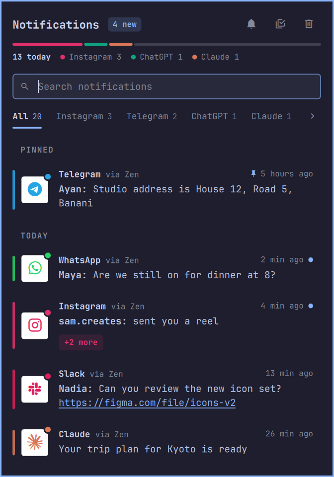
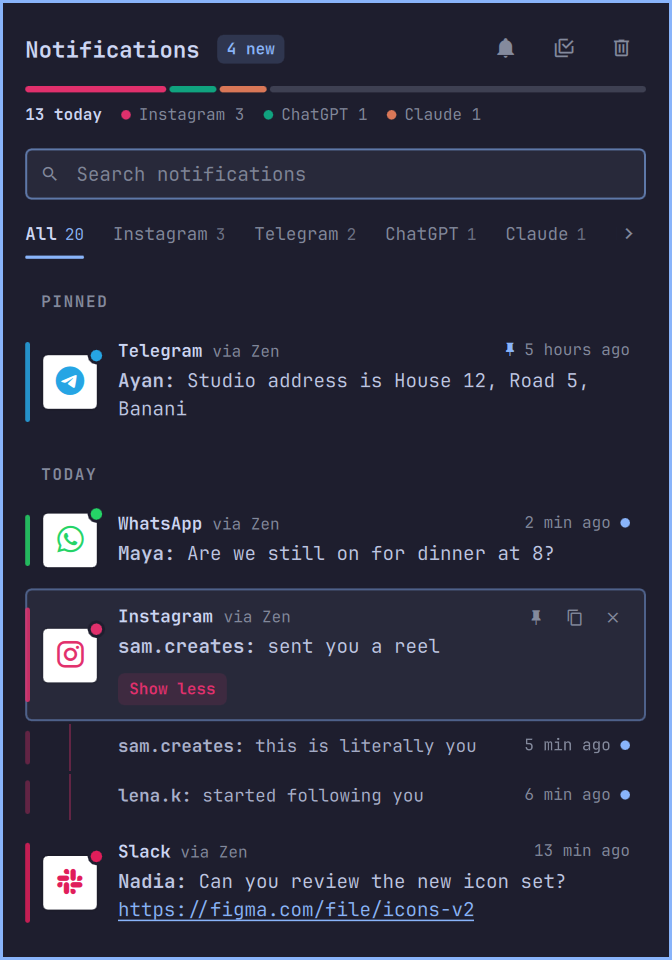
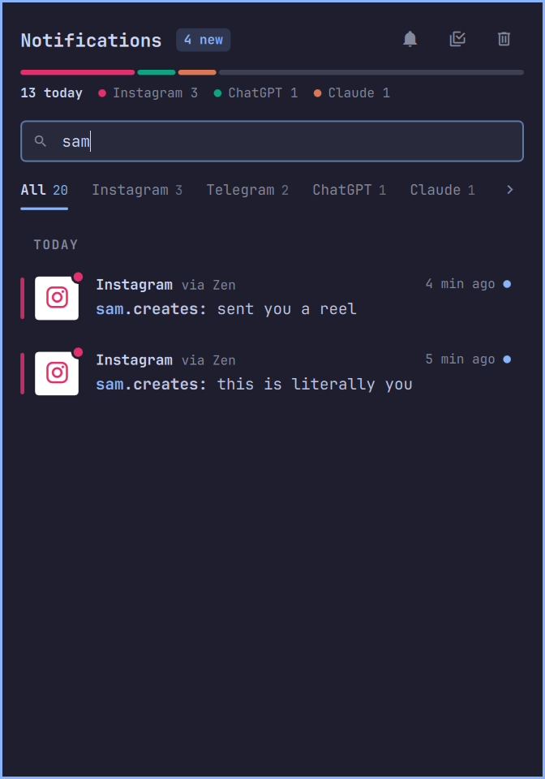
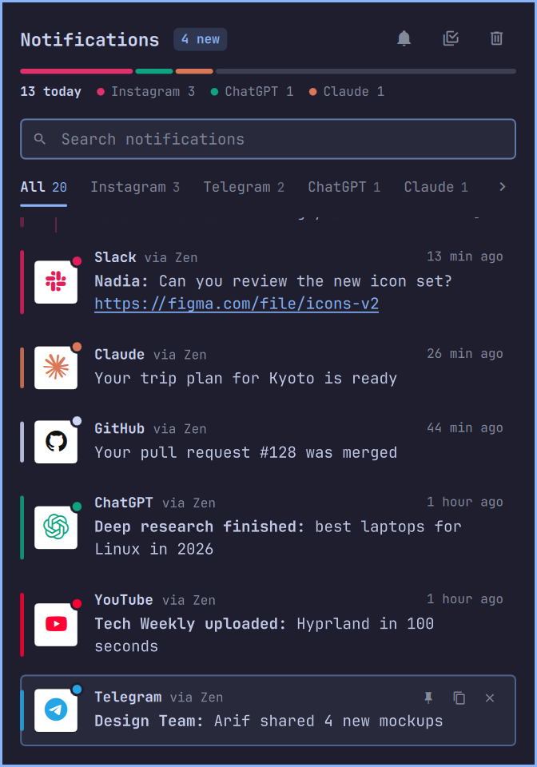

# Notification Pulse

A notification inbox for the Omarchy bar. A bell that pulses in the colour of whoever just messaged you, and an inbox that keeps a week of history, knows which site a browser notification came from, and is fully keyboard driven.



## Features

- **A bell that pulses.** When a notification arrives the bell swings and a ring ripples out in the sender's colour: green for WhatsApp, pink for Instagram, red for YouTube. The unread badge takes the same colour for a moment.
- **Knows the site behind the browser.** A notification your browser sends for Instagram shows as *Instagram · via Zen*, with the Instagram logo in its own colour on a white tile, a brand-coloured corner dot and an edge stripe. 50+ sites and apps are recognised, among them WhatsApp, Telegram, Messenger, Signal, Discord, Slack, Teams, Instagram, Facebook, X, Threads, Bluesky, Mastodon, Reddit, LinkedIn, TikTok, Pinterest, Substack, Medium, ChatGPT, Claude, Gemini, Copilot, Perplexity, YouTube, Twitch, Netflix, Spotify, Gmail, Google Calendar, Meet, Drive, Outlook, Zoom, Notion, Figma, Trello, Jira, GitHub and GitLab.
- **Sender names.** When a site puts the sender in the text (`maya: are we still on?`), it is shown as **maya:** are we still on?
- **Grouping.** Back-to-back notifications from one site fold into one row with a **+2 more** button.
- **Clickable links** open in your browser.
- **Pins.** Pin a notification to keep it at the top. Pins never expire and survive Clear.
- **Search** with highlighted matches, and **site tabs** that scroll with the wheel, the ‹ › arrows or Tab / Shift+Tab.
- **Today at a glance:** a colour bar and "13 today · Instagram 3 · ChatGPT 1".
- Keeps **7 days** of history by default; Omarchy on its own keeps 24 hours.
- Unknown sites get a stable letter tile, so "Daily Brief" is always the same coloured **D**.
- Click a notification to jump to the window that sent it.

| Grouped, keyboard selection | Search | More sites |
|---|---|---|
|  |  |  |

The screenshots use made-up demo notifications.

## Install

**Requirements**
- Omarchy 4, which provides the Quickshell-based `omarchy-shell`.
- Omarchy's built-in notifications (`omarchy.notifications`) enabled. That is the default.
- A Nerd Font for the logos. Omarchy's default fonts include one.
- `wl-copy` (copy) and `xdg-open` (links). Both ship with Omarchy.
- No accounts, API keys or extra services.

```bash
omarchy plugin add https://github.com/iammhador/omarchy-notification-pulse.git --enable
```

It lands on the right side of the bar. To move it:

```bash
omarchy bar move io.github.iammhador.notification-pulse --section right --index 0
```

Optional keyboard shortcut, in `~/.config/hypr/bindings.lua`:

```lua
o.bind("SUPER + N", "Notification inbox", "omarchy-shell notification-pulse toggle")
```

## Using it

| Where | Action |
|---|---|
| Bell, left click | Open the inbox |
| Bell, right click | Do Not Disturb on/off |
| Bell, middle click | Mark all read |
| Notification | Jump to the app that sent it |
| Notification, hover | Pin · Copy · Remove |
| Link | Open in your browser |
| 🗑 | Click, then click **Clear all?** to confirm (pins are kept) |

| Key (inbox open) | Action |
|---|---|
| type | Search |
| ↑ ↓ · PgUp PgDn | Move through notifications |
| Enter | Open the selected (or top) notification's app |
| → ← | Expand / collapse a group |
| Ctrl+P | Pin / unpin |
| Ctrl+C | Copy |
| Delete | Remove |
| Tab · Shift+Tab | Next / previous site tab |
| Esc | Clear selection, then search, then close |

## Settings

On the widget's entry in `~/.config/omarchy/shell.json`, or with `omarchy bar set`:

| Key | Default | |
|---|---|---|
| `retentionDays` | `7` | Days of history to keep, 1–90 |
| `maxEntries` | `500` | Most notifications to keep, 50–2000 |
| `showBadge` | `true` | Unread count on the bell |
| `pulse` | `true` | Swing the bell when something arrives |
| `groupSenders` | `true` | Fold back-to-back notifications from one site |
| `showToday` | `true` | Today-at-a-glance strip |
| `unknownIcon` | `letter` | Unknown sites: `letter` tile, or the browser's `app` icon |

## Scripting

```bash
omarchy-shell notification-pulse toggle      # also: open, close
omarchy-shell notification-pulse search "maya"
omarchy-shell notification-pulse unread      # number of unread notifications
omarchy-shell notification-pulse markRead
omarchy-shell notification-pulse clear       # clears history, keeps pins
omarchy-shell notification-pulse pulse       # play the bell animation
```

## Uninstall

```bash
omarchy plugin remove io.github.iammhador.notification-pulse
rm -rf ~/.local/state/notification-pulse   # optional: the saved history
```

Remove the `SUPER + N` line from `~/.config/hypr/bindings.lua` if you added it.

## Privacy

Everything stays on your machine. The plugin only reads Omarchy's own notification files in `~/.local/state/omarchy/notifications/`, and never writes to them. It keeps its history in `~/.local/state/notification-pulse/archive.json`, readable only by you (folder `0700`, file `0600`). It makes no network requests. Logos come from your font; no favicon is ever fetched.

Notification text is shown as plain text. Anything that looks like markup in a message stays literal text, and only `http(s)` addresses become links. A clicked link is passed to `xdg-open` as an argument, never through a shell.

## Limitations

- **Websites decide what they send.** Some messages arrive without a sender name; nothing can add one.
- **No favicons.** Firefox-based browsers (Zen, Firefox, LibreWolf) send the site's title but not its address, and Omarchy does not keep notification images, so unknown sites get a letter tile.
- Firefox-based browsers are recognised by the notification title ("Instagram"). Chromium-based browsers and web apps also send the address, which makes recognition work even when the title is a person's name.

## Development

```bash
node tests/model.test.js
```

`Model.js` holds all data handling, site detection and text escaping, and is covered by the tests. `BarWidget.qml` is the bar icon and the inbox.

## License

MIT. See [LICENSE](LICENSE). Brand names and logos belong to their owners and are used only to identify where a notification came from.
